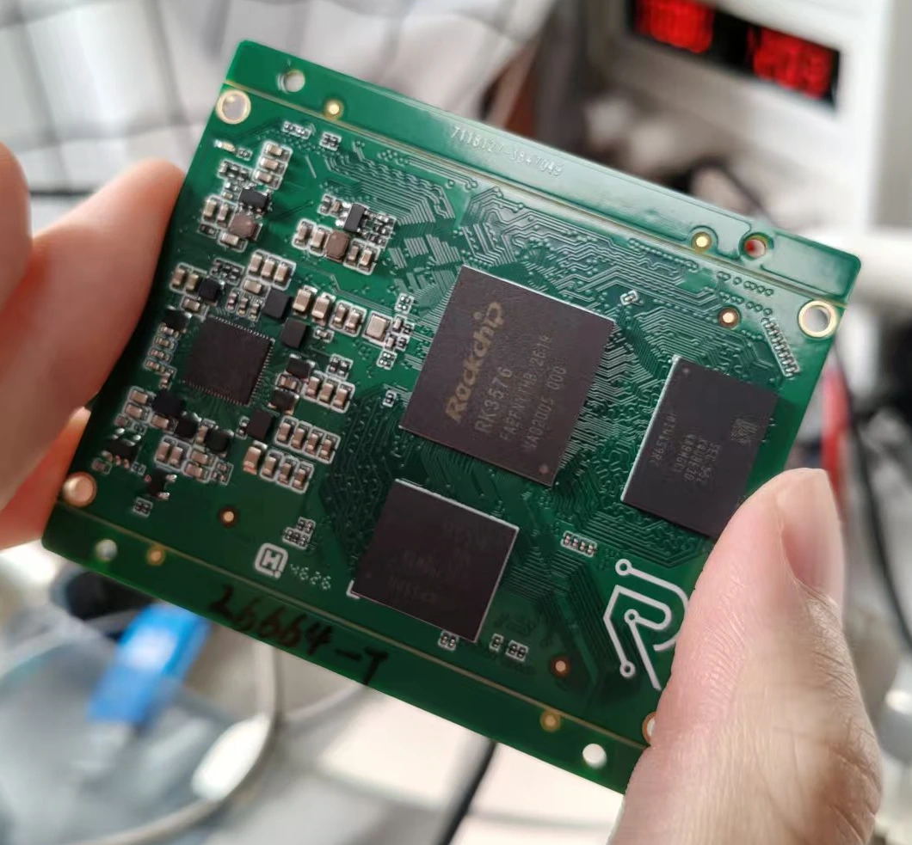
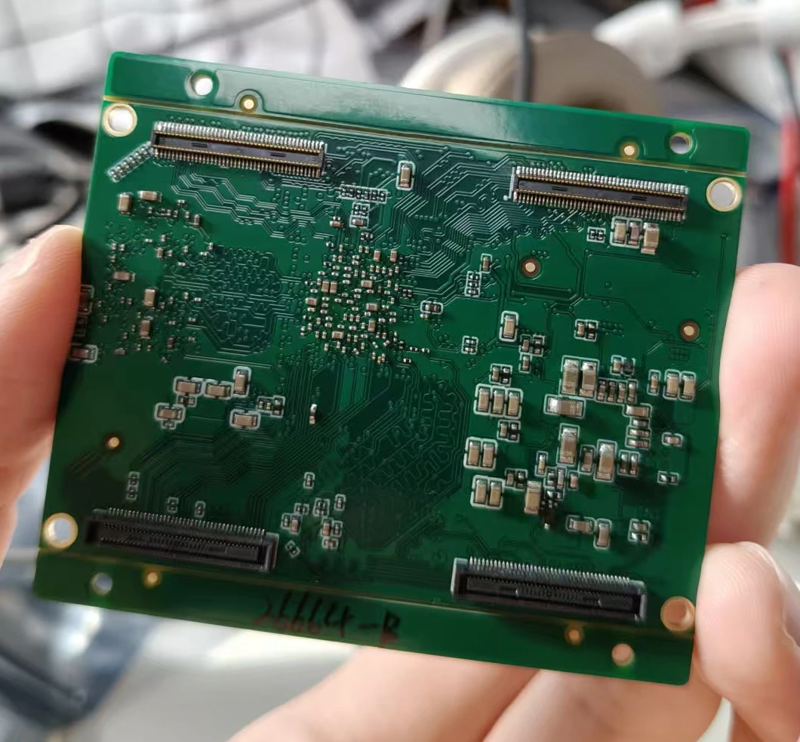
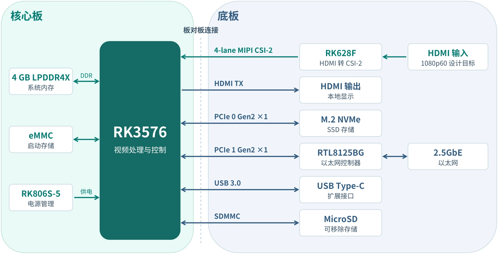
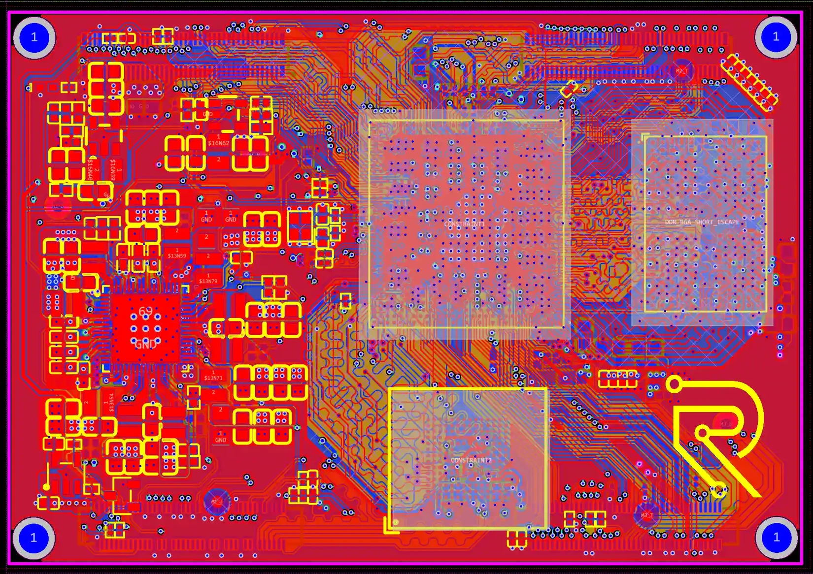
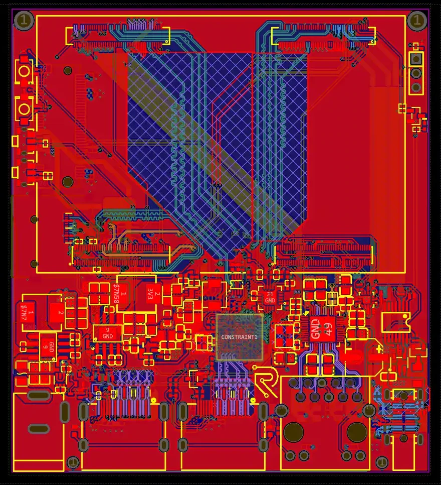

# RK3576 网络化音视频处理与存储平台

面向工业相机和现场监控的硬件项目。底板将 HDMI 输入经 RK628F 转为 MIPI CSI-2，送入 RK3576。平台可将处理后的数据写入 NVMe SSD、通过 2.5GbE 传输，也可由 HDMI 接口输出画面。我负责核心板和底板的器件选型、原理图及 PCB 布局布线。

核心板正面和背面实拍。

**[项目展示 PDF](docs/RK3576-Project-Portfolio.pdf)** · **[下载核心板 EDA](hardware/core-board/RK3576-Core.epro2?raw=true)** · **[下载底板 EDA](hardware/carrier-board/RK3576-Carrier.epro2?raw=true)** · [硬件工程索引](hardware/)

## 系统框图

## 核心板

- **SoC、电源和启动。** RK3576 搭配 4 GB LPDDR4X、eMMC 和 RK806S-5。设计了 Buck/LDO 电源树、DDR 供电、VCCIO 电压域、上电配置、USB 下载、UART 和复位电路。
- **八层 PCB。** 处理 BGA 扇出、LPDDR4X 字节组内等长和 DQ/DQS 匹配，并按高速信号的换层和回流路径布置参考平面。核心板设置了 L2、L5、L7 地参考层。

[查看核心板全层 PCB 截图](docs/images/core-routing-overview.webp)

## 底板

| 链路 | 硬件设计 |
| --- | --- |
| HDMI 视频输入 | HDMI 2.0 → RK628F → 4-lane MIPI CSI-2 → RK3576。输入设计目标为 1080p60 |
| 本地存储 | PCIe 0 Gen2 ×1 → M.2 NVMe SSD |
| 网络传输 | PCIe 1 Gen2 ×1 → RTL8125BG → 2.5GbE |
| 本地显示与扩展 | RK3576 原生 HDMI TX，以及 USB 3.0 Type-C 和 MicroSD（SDMMC） |

底板也采用八层 PCB。两路 PCIe 分别设计参考时钟、AC 耦合、复位及供电。PCIe 数据对的差分阻抗设计目标为 85 Ω，REFCLK 为 100 Ω。

底板实物照片待补。图表中的接口速率、分辨率和阻抗为设计规格。
